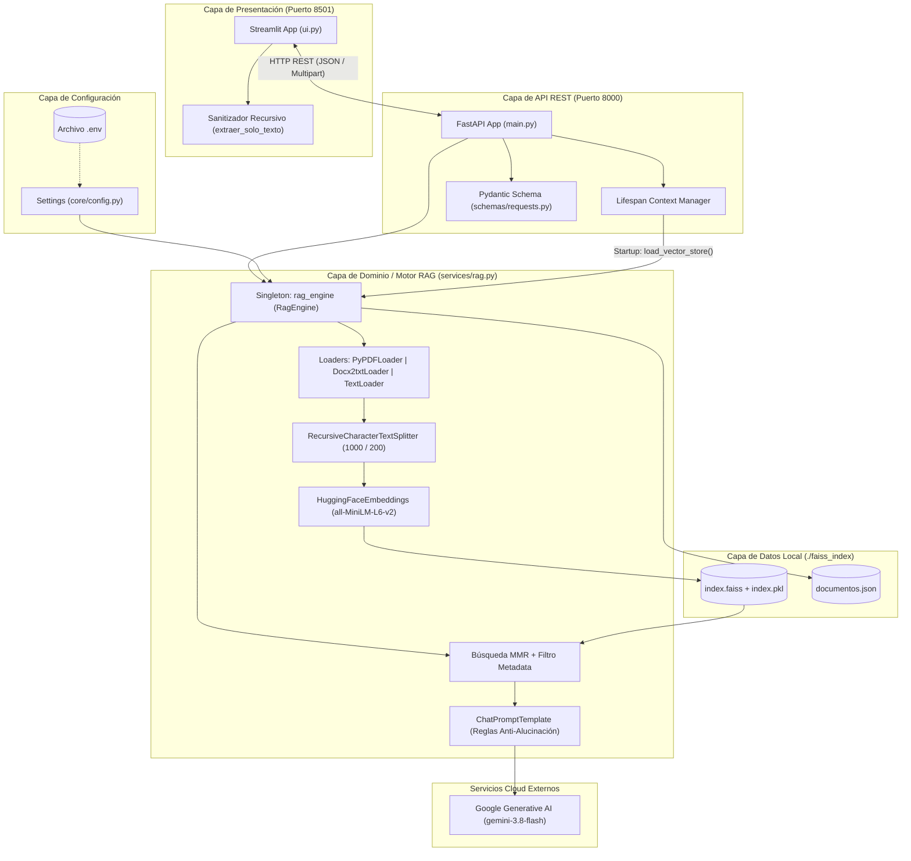
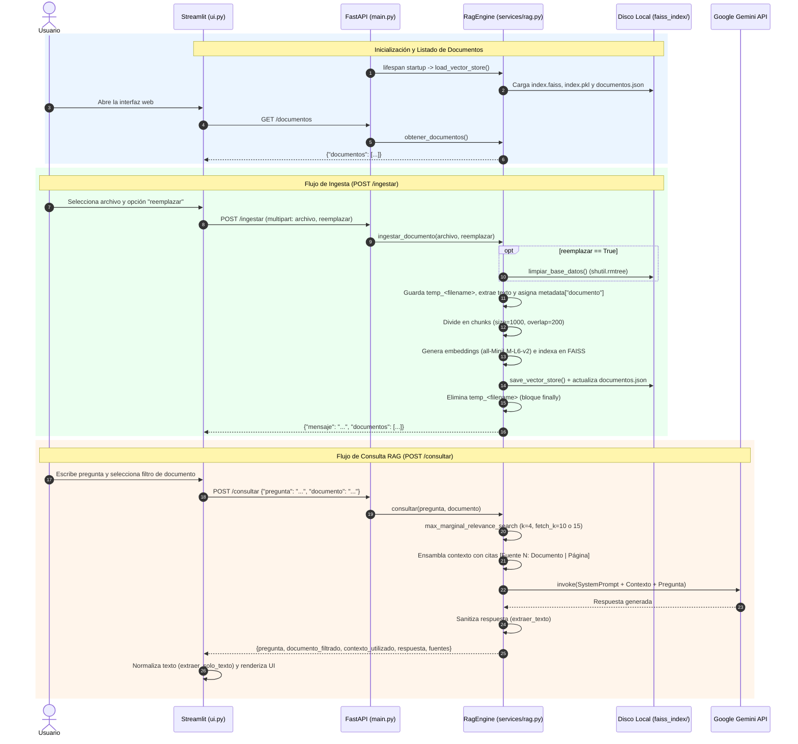

# 📘 Documentación Técnica — DocuMind AI (v2.0)

## **Sistema de Generación Aumentada por Recuperación (RAG) para Análisis y Consulta de Documentos**

---

## Tabla de Contenidos

1. [Resumen Ejecutivo](#1-resumen-ejecutivo)
2. [Arquitectura del Sistema](#2-arquitectura-del-sistema)
3. [Estructura del Proyecto y Módulos](#3-estructura-del-proyecto-y-módulos)
4. [Diseño Detallado de Componentes](#4-diseño-detallado-de-componentes)
   - 4.1 [Configuración Centralizada (`core/config.py`)](#41-configuración-centralizada-coreconfigpy)
   - 4.2 [Esquemas de Datos (`schemas/requests.py`)](#42-esquemas-de-datos-schemasrequestspy)
   - 4.3 [Motor RAG (`services/rag.py`)](#43-motor-rag-servicesragpy)
   - 4.4 [Servidor API REST (`main.py`)](#44-servidor-api-rest-mainpy)
   - 4.5 [Cliente Web Interactivo (`ui.py`)](#45-cliente-web-interactivo-uipy)
5. [Pipelines de Procesamiento e Inteligencia Artificial](#5-pipelines-de-procesamiento-e-inteligencia-artificial)
   - 5.1 [Pipeline de Ingesta, Fragmentación y Vectorización](#51-pipeline-de-ingesta-fragmentación-y-vectorización)
   - 5.2 [Pipeline de Recuperación (MMR) y Generación (LLM)](#52-pipeline-de-recuperación-mmr-y-generación-llm)
   - 5.3 [Ingeniería de Prompts y Reglas de Grounding](#53-ingeniería-de-prompts-y-reglas-de-grounding)
6. [Especificación de la API REST](#6-especificación-de-la-api-rest)
7. [Persistencia y Modelo de Almacenamiento Vectorial](#7-persistencia-y-modelo-de-almacenamiento-vectorial)
8. [Infraestructura y Despliegue en Contenedores](#8-infraestructura-y-despliegue-en-contenedores)
9. [Manejo de Errores, Seguridad y Limitaciones Técnicas](#9-manejo-de-errores-seguridad-y-limitaciones-técnicas)
10. [Dependencias y Stack Tecnológico](#10-dependencias-y-stack-tecnológico)

---

## 1. Resumen Ejecutivo

**DocuMind AI** es una plataforma de **Retrieval-Augmented Generation (RAG)** con arquitectura cliente-servidor desacoplada que permite ingestar documentos no estructurados (`PDF`, `DOCX`, `DOC` y `TXT`), indexarlos en una base de datos vectorial local (**FAISS**) y realizar consultas en lenguaje natural asistidas por **Google Gemini**.

### Características Técnicas Principales

- **Separación Frontend / Backend**: Interfaz de usuario reactiva en **Streamlit** (`ui.py`) comunicada vía HTTP/REST con un backend asíncrono en **FastAPI** (`main.py`).
- **Vectorización Local sin Costo de API**: Generación de embeddings densos de 384 dimensiones en CPU mediante `sentence-transformers/all-MiniLM-L6-v2` (HuggingFace).
- **Recuperación Diversificada con MMR**: Uso del algoritmo *Maximal Marginal Relevance* (`max_marginal_relevance_search`) para equilibrar similitud semántica y diversidad de contexto.
- **Aislamiento Documental**: Soporte para filtrado por archivo específico en tiempo de consulta, modo de reemplazo total durante la ingesta y reglas estrictas de *system prompt* para evitar la contaminación cruzada entre documentos.
- **Trazabilidad Completa**: Cada respuesta incluye las fuentes documentales consultadas, el número de página (en archivos PDF) y los fragmentos exactos utilizados por el modelo generativo.

---

## 2. Arquitectura del Sistema

### 2.1 Diagrama de Arquitectura de Componentes (v2.0)



### 2.2 Diagrama de Secuencia de Operaciones



---

## 3. Estructura del Proyecto y Módulos

```text
WelcomeScreen/
├── core/
│   └── config.py              # Configuración global y carga de variables de entorno (Pydantic Settings)
├── schemas/
│   └── requests.py            # Contratos de validación de entrada para endpoints REST
├── services/
│   └── rag.py                 # Motor principal RAG: ingesta, chunking, FAISS, MMR y llamadas a Gemini
├── faiss_index/               # Directorio de persistencia vectorial (creado dinámicamente)
│   ├── index.faiss            # Índice vectorial binario de FAISS
│   ├── index.pkl              # Docstore serializado (fragmentos de texto y metadatos)
│   └── documentos.json        # Catálogo persistente de nombres de archivos ingestados
├── flowchart/
│   └── flowchart.mmd          # Diagrama de flujo en formato Mermaid
├── main.py                    # Punto de entrada del servidor backend FastAPI
├── ui.py                      # Punto de entrada de la interfaz gráfica Streamlit
├── Dockerfile                 # Definición de imagen Docker basada en python:3.11-slim
├── docker-compose.yml         # Orquestación multicontenedor (servicios api y ui + volumen)
├── requirements.txt           # Lista de dependencias con versiones fijadas (pinned)
├── .env.example               # Plantilla de variables de entorno requeridas
└── README.md                  # Guía rápida de usuario
```

---

## 4. Diseño Detallado de Componentes

### 4.1 Configuración Centralizada (`core/config.py`)

Utiliza `pydantic_settings.BaseSettings` para validar y exponer una instancia única `settings`:

| Parámetro | Tipo | Valor por Defecto | Origen | Descripción |
| :--- | :--- | :--- | :--- | :--- |
| `GOOGLE_API_KEY` | `str` | `""` | Variable de entorno / `.env` | Clave de autenticación para Google Generative AI. |
| `MODEL_NAME` | `str` | `"gemini-3.8-flash"` | `core/config.py` | Identificador del modelo generativo de Google Gemini. |
| `EMBEDDINGS_MODEL` | `str` | `"sentence-transformers/all-MiniLM-L6-v2"` | `core/config.py` | Modelo local de HuggingFace para transformación de texto a vectores. |

---

### 4.2 Esquemas de Datos (`schemas/requests.py`)

Define el modelo de validación de datos para el endpoint de consulta:

```python
class PeticionConsulta(BaseModel):
    pregunta: str
    documento: Optional[str] = None
```

- **`pregunta`** (*obligatorio*): Consulta en lenguaje natural formulada por el usuario.

- **`documento`** (*opcional*): Nombre exacto del archivo sobre el cual restringir la búsqueda vectorial. Si es `None` o `"Todos los documentos"`, la búsqueda se realiza sobre todo el índice.

---

### 4.3 Motor RAG (`services/rag.py`)

Contiene la clase `RagEngine` y expone el singleton global `rag_engine`.

#### Atributos de Estado de `RagEngine`

- `self.vector_store`: Instancia de `langchain_community.vectorstores.FAISS` o `None` si no hay documentos indexados.
- `self.documentos_cargados`: Lista en memoria (`List[str]`) con los nombres de los archivos indexados.
- `self.embeddings_modelo`: Instancia de `HuggingFaceEmbeddings` inicializada al arrancar el proceso.
- `self.llm_modelo`: Instancia de `ChatGoogleGenerativeAI` con `temperature=0.2` (o `None` si `GOOGLE_API_KEY` no está definida).

#### Métodos Principales de `RagEngine`

| Método | Firma | Responsabilidad Técnica |
| :--- | :--- | :--- |
| `__init__` | `() -> None` | Inicializa el modelo de embeddings en memoria y configura el cliente de Gemini si existe `GOOGLE_API_KEY`. |
| `load_vector_store` | `(store_path="faiss_index") -> None` | Carga el índice FAISS local al iniciar la API. Si `documentos.json` no existe, reconstruye la lista de documentos inspeccionando `vector_store.docstore._dict`. |
| `save_vector_store` | `(store_path="faiss_index") -> None` | Persiste el índice FAISS en disco (`save_local`) y serializa `self.documentos_cargados` en `faiss_index/documentos.json`. |
| `limpiar_base_datos` | `(store_path="faiss_index") -> dict` | Reinicia `self.vector_store = None`, vacía `self.documentos_cargados` y elimina recursivamente el directorio `faiss_index/` del disco. |
| `obtener_documentos` | `() -> List[str]` | Retorna la lista actual de documentos cargados (`self.documentos_cargados`). |
| `ingestar_documento` | `(archivo: UploadFile, reemplazar: bool = False) -> dict` | Ejecuta el flujo completo de extracción, particionado en chunks, asignación de metadatos, generación de embeddings y guardado en disco. |
| `consultar` | `(pregunta: str, documento: Optional[str] = None) -> dict` | Ejecuta la recuperación semántica MMR con filtrado opcional, construye el prompt con trazabilidad de fuentes e invoca al LLM. |

---

### 4.4 Servidor API REST (`main.py`)

Implementa la aplicación FastAPI (`title="DocuMind AI API"`, `version="2.0"`):

- **Gestión de Ciclo de Vida (`lifespan`)**: Utiliza `@asynccontextmanager` para invocar `rag_engine.load_vector_store()` antes de aceptar peticiones HTTP, garantizando que los índices previos en disco estén disponibles inmediatamente en memoria tras un reinicio del contenedor o servidor.

- **Controladores Delgados (*Thin Controllers*)**: Los 4 endpoints delegan toda la lógica de negocio a `rag_engine`.

---

### 4.5 Cliente Web Interactivo (`ui.py`)

Aplicación desarrollada en **Streamlit** que consume la API mediante la librería `requests`.

- **Resolución de Endpoint Backend**: Lee la variable de entorno `API_URL` (por defecto `http://localhost:8000` en desarrollo local y `http://api:8000` dentro de la red de Docker Compose).

- **Gestión de Estado y Sincronización**:
  - Al cargar la vista, consulta `GET /documentos` con un `timeout=5` segundos para poblar tanto la barra lateral como el selector de filtrado de documentos.
  - Tras ingestar un archivo o vaciar la base de datos, ejecuta `st.rerun()` para refrescar inmediatamente el estado visual.
- **Sanitización Defensiva de Salida (`extraer_solo_texto`)**:
  - Algunas versiones o respuestas estructuradas de LangChain/Gemini pueden devolver listas de bloques o cadenas con formato JSON/diccionario Python (`{'type': 'text', 'text': '...'}`).
  - La función `extraer_solo_texto(valor)` inspecciona recursivamente cadenas (`json.loads` y `ast.literal_eval`), listas y diccionarios (extrayendo claves `"text"` o `"content"` y descartando metadatos como `"type"`, `"extras"`, `"signature"`) para garantizar que el usuario final siempre visualice Markdown limpio.

---

## 5. Pipelines de Procesamiento e Inteligencia Artificial

### 5.1 Pipeline de Ingesta, Fragmentación y Vectorización

1. **Escritura Temporal Segura**:
   El stream binario de `UploadFile` se copia a `temp_<archivo.filename>` en el directorio de trabajo. Un bloque `finally` asegura su eliminación mediante `os.remove()` incluso si ocurre una excepción durante el parseo o vectorización.
2. **Selección de Cargador (*Document Loader*)**:
   - `.pdf` $\rightarrow$ `PyPDFLoader`: Extrae texto por página y añade automáticamente `metadata["page"]` (índice base 0).
   - `.docx` / `.doc` $\rightarrow$ `Docx2txtLoader`: Extrae el cuerpo de texto completo de documentos Microsoft Word.
   - Otros formatos (`.txt`) $\rightarrow$ `TextLoader(encoding="utf-8")`: Lectura directa en UTF-8.
3. **Estrategia de Fragmentación (*Chunking*)**:
   Se emplea `RecursiveCharacterTextSplitter` con la siguiente configuración:
   - **`chunk_size = 1000`** caracteres por fragmento.
   - **`chunk_overlap = 200`** caracteres de solapamiento entre fragmentos consecutivos (20%), evitando cortar ideas o cláusulas a mitad de una oración.
   - **`length_function = len`**.
4. **Etiquetado de Metadatos**:
   Tanto en los documentos originales como en cada fragmento resultante se inyecta explícitamente:

   ```python
   frag.metadata["documento"] = archivo.filename
   ```

5. **Vectorización y Almacenamiento**:
   Cada fragmento es transformado en un vector denso en $\mathbb{R}^{384}$ mediante `sentence-transformers/all-MiniLM-L6-v2` y añadido al índice FAISS en memoria y en disco.

---

### 5.2 Pipeline de Recuperación (MMR) y Generación (LLM)

En lugar de una búsqueda por similitud coseno simple (que tiende a recuperar fragmentos casi idénticos de una misma sección), el sistema utiliza **Maximal Marginal Relevance (MMR)** a través de `vector_store.max_marginal_relevance_search`:

$$\text{MMR} = \arg\max_{D_i \in R \setminus S} \left[ \lambda \cdot \text{Sim}_1(D_i, Q) - (1 - \lambda) \cdot \max_{D_j \in S} \text{Sim}_2(D_i, D_j) \right]$$

#### Parámetros de Recuperación según Alcance

| Escenario de Consulta | `k` (Fragmentos finales) | `fetch_k` (Candidatos iniciales) | Función de Filtrado (`filter`) |
| :--- | :---: | :---: | :--- |
| **Global** (`Todos los documentos`) | `4` | `10` | `None` |
| **Filtrada** (Documento específico) | `4` | `15` | `filtro_fn(metadata)` que valida `metadata["documento"] == doc_target` |

> **Nota técnica:** Cuando se aplica un filtro por documento, `fetch_k` se incrementa de `10` a `15` para ampliar el conjunto de candidatos evaluados por FAISS y asegurar suficiente diversidad dentro del documento seleccionado.

#### Formato de Ensamblaje de Contexto

Cada uno de los `k` fragmentos recuperados se formatea con un encabezado de procedencia antes de enviarse al LLM:

```text
[Fuente 1: Documento 'informe_anual.pdf' | Página 4]
<contenido del fragmento 1>

---

[Fuente 2: Documento 'informe_anual.pdf' | Página 12]
<contenido del fragmento 2>
```

---

### 5.3 Ingeniería de Prompts y Reglas de Grounding

El motor construye un `ChatPromptTemplate` compuesto por un mensaje `system` y un mensaje `human` (`{input}`), utilizando una temperatura baja (`temperature=0.2`) en `ChatGoogleGenerativeAI`.

Las **5 reglas estrictas** definidas en el prompt del sistema son:

1. **Fidelidad estricta al contexto (*Zero External Knowledge*)**: Prohibición de agregar información externa o extrapolar datos ausentes en los fragmentos.

2. **Cita obligatoria de fuentes**: Obligación de indicar de qué documento (y página, si aplica) proviene cada afirmación.

3. **Prohibición de mezclar documentos o proyectos distintos**: Si los fragmentos recuperados pertenecen a diferentes archivos, el modelo debe tratarlos de forma independiente sin fusionarlos como si fueran un único proyecto.

4. **Enfoque temático**: Respuesta circunscrita únicamente al documento o tema solicitado por el usuario.

5. **Abstención controlada (*Fallback*)**: Si la respuesta no se encuentra en el contexto, el modelo debe responder literalmente: `"No dispongo de esa información en los fragmentos analizados."`

---

## 6. Especificación de la API REST

### 6.1 `POST /ingestar`

Procesa, fragmenta y vectoriza un archivo subido por el usuario.

- **Content-Type**: `multipart/form-data`
- **Parámetros del Formulario**:
  - `archivo` (`file`, requerido): Archivo binario (`.pdf`, `.docx`, `.doc`, `.txt`).
  - `reemplazar` (`bool`, opcional, por defecto `False`): Si es `True`, elimina toda la base de datos vectorial previa antes de indexar el nuevo archivo.
- **Respuesta Exitosa (`200 OK`)**:

  ```json
  {
    "mensaje": "Documento 'manual_tecnico.pdf' procesado exitosamente. Se generaron 24 fragmentos.",
    "documentos": ["manual_tecnico.pdf"]
  }
  ```

- **Errores Posibles**:
  - `422 Unprocessable Entity`: Falta el parámetro `archivo`.
  - `500 Internal Server Error`: Error durante la lectura del archivo, generación de embeddings o escritura en disco.

---

### 6.2 `POST /consultar`

Realiza una búsqueda semántica MMR en el índice vectorial y genera una respuesta fundamentada con Gemini.

- **Content-Type**: `application/json`
- **Cuerpo de la Petición (`PeticionConsulta`)**:

  ```json
  {
    "pregunta": "¿Cuáles son los requisitos de instalación?",
    "documento": "manual_tecnico.pdf"
  }
  ```

  *(El campo `"documento"` es opcional; puede omitirse o enviarse como `null` para consultar todos los documentos).*
- **Respuesta Exitosa (`200 OK`)**:

  ```json
  {
    "pregunta": "¿Cuáles son los requisitos de instalación?",
    "documento_filtrado": "manual_tecnico.pdf",
    "contexto_utilizado": "[Fuente 1: Documento 'manual_tecnico.pdf' | Página 2]\n...",
    "respuesta": "Según el documento 'manual_tecnico.pdf' (Página 2), los requisitos son...",
    "fuentes": ["manual_tecnico.pdf"]
  }
  ```

- **Errores Posibles**:
  - `400 Bad Request`: La base de conocimiento está vacía (`vector_store is None`).
  - `500 Internal Server Error`: `GOOGLE_API_KEY` no configurada (`llm_modelo is None`) o fallo de comunicación con la API de Google Gemini.

---

### 6.3 `GET /documentos`

Devuelve la lista de nombres de documentos actualmente indexados en la base de conocimiento.

- **Respuesta Exitosa (`200 OK`)**:

  ```json
  {
    "documentos": [
      "manual_tecnico.pdf",
      "notas_reunion.docx"
    ]
  }
  ```

---

### 6.4 `POST /limpiar`

Elimina todos los vectores en memoria y borra el directorio `faiss_index/` del almacenamiento local.

- **Respuesta Exitosa (`200 OK`)**:

  ```json
  {
    "mensaje": "Base de conocimiento limpiada exitosamente. El índice está vacío."
  }
  ```

---

## 7. Persistencia y Modelo de Almacenamiento Vectorial

El estado persistente del sistema reside en la carpeta `./faiss_index`:

1. **`index.faiss`**: Estructura de datos nativa de C++ generada por `faiss-cpu` que almacena los vectores en espacio métrico $L_2$ / producto interno para búsqueda rápida de vecinos cercanos.
2. **`index.pkl`**: Archivo serializado con `pickle` que contiene el `InMemoryDocstore` de LangChain (mapeo de IDs internos a objetos `Document(page_content=..., metadata=...)`).
3. **`documentos.json`**: Archivo JSON en UTF-8 que mantiene el arreglo ordenado de nombres de documentos cargados (`["doc1.pdf", "doc2.txt"]`).

### Mecanismo de Recuperación Resiliente (`load_vector_store`)

Al iniciar la aplicación:

1. Verifica si existe el directorio `faiss_index/`.

2. Carga el índice con `FAISS.load_local(..., allow_dangerous_deserialization=True)`.

3. Intenta leer `faiss_index/documentos.json`.

4. **Fallback automático**: Si `documentos.json` no existe o fue eliminado manualmente, el sistema recorre todos los valores de `self.vector_store.docstore._dict.values()`, extrae `metadata["documento"]` (o limpia el prefijo `temp_` de `metadata["source"]`) y reconstruye automáticamente el catálogo en memoria.

---

## 8. Infraestructura y Despliegue en Contenedores

### 8.1 Imagen Docker (`Dockerfile`)

- **Imagen Base**: `python:3.11-slim` (optimizada en tamaño).
- **Variables de Entorno del Contenedor**:
  - `PYTHONDONTWRITEBYTECODE=1` (evita la generación de archivos `.pyc`).
  - `PYTHONUNBUFFERED=1` (envía logs de Uvicorn y Streamlit directamente a `stdout`/`stderr` sin buffering).
- **Paquetes del Sistema**: Instala `curl` para permitir la ejecución del `healthcheck` del contenedor de la API.
- **Puertos Expuestos**: `8000` (FastAPI) y `8501` (Streamlit).

### 8.2 Orquestación con Docker Compose (`docker-compose.yml`)

| Servicio | Nombre de Contenedor | Comando de Arranque | Puerto Host:Contenedor | Volúmenes / Variables Clave |
| :--- | :--- | :--- | :---: | :--- |
| **`api`** | `documind-api` | `uvicorn main:app --host 0.0.0.0 --port 8000` | `8000:8000` | `env_file: .env`; Volumen: `./faiss_index:/app/faiss_index`; Healthcheck: `curl -f http://localhost:8000/docs` cada 10s |
| **`ui`** | `documind-ui` | `streamlit run ui.py --server.port 8501 --server.address 0.0.0.0` | `8501:8501` | `API_URL=http://api:8000`; `depends_on: api` (`service_started`) |

---

## 9. Manejo de Errores, Seguridad y Limitaciones Técnicas

### 9.1 Seguridad y Buenas Prácticas Implementadas

- **Aislamiento de Credenciales**: La clave `GOOGLE_API_KEY` nunca se expone al cliente Streamlit (`ui.py`); todas las llamadas al LLM ocurren exclusivamente en el backend (`services/rag.py`).
- **Limpieza Garantizada de Archivos Temporales**: Uso de bloques `try...finally` en `ingestar_documento()` para evitar acumulación de archivos `temp_*` en el sistema de archivos ante fallos de lectura.
- **Deserialización Local Controlada**: El uso de `allow_dangerous_deserialization=True` al cargar `index.pkl` es seguro siempre que el directorio `./faiss_index` tenga permisos de escritura restringidos exclusivamente al proceso de la API.

### 9.2 Consideraciones Operativas y Limitaciones Actuales

1. **Concurrencia de Proceso Único**: Dado que `rag_engine` mantiene el estado de FAISS en memoria RAM dentro del proceso de Python, el servidor Uvicorn debe ejecutarse con un único *worker* (`--workers 1`, valor por defecto). Si se escalara a múltiples *workers*, cada proceso tendría una copia desincronizada de `self.vector_store` en memoria.
2. **Documentos PDF Escaneados (Imágenes)**: `PyPDFLoader` extrae texto embebido en el PDF. Los documentos escaneados sin capa de texto requieren un paso previo de OCR (p. ej., Tesseract o Document AI) para generar fragmentos con contenido.
3. **Eliminación Granular**: Actualmente la limpieza del índice es global (`POST /limpiar` o `reemplazar=True`). Para eliminar un único documento manteniendo los demás, se debe volver a ingestar el subconjunto deseado.

---

## 10. Dependencias y Stack Tecnológico

| Categoría | Paquete | Versión (`requirements.txt`) | Propósito en el Proyecto |
| :--- | :--- | :---: | :--- |
| **API & Servidor ASGI** | `fastapi` | `0.143.0` | Framework web asíncrono y generación de OpenAPI/Swagger. |
| | `uvicorn` | `0.54.0` | Servidor ASGI de alto rendimiento. |
| | `python-multipart` | `0.0.32` | Soporte para subida de archivos (`UploadFile` y `Form`). |
| **Configuración** | `pydantic-settings` | `2.15.0` | Gestión tipada de configuración desde variables de entorno. |
| | `python-dotenv` | `1.2.4` | Carga de archivos `.env`. |
| **Orquestación IA (LangChain)** | `langchain` | `1.4.4` | Framework principal de cadenas y componentes RAG. |
| | `langchain-core` | `1.6.9` | Primitivas base (`ChatPromptTemplate`, `Document`). |
| | `langchain-community` | `0.3.31` | Integraciones de cargadores de documentos y vectorstore FAISS. |
| | `langchain-text-splitters` | `1.1.3` | Particionado recursivo de texto (`RecursiveCharacterTextSplitter`). |
| | `langchain-google-genai` | `4.4.0` | Conector oficial para modelos Google Gemini (`ChatGoogleGenerativeAI`). |
| | `langchain-huggingface` | `1.2.3` | Conector para modelos de embeddings locales (`HuggingFaceEmbeddings`). |
| **Embeddings & Vector DB** | `sentence-transformers` | `6.1.0` | Ejecución local del modelo `all-MiniLM-L6-v2`. |
| | `faiss-cpu` | `1.15.1` | Motor de búsqueda vectorial e indexación en CPU. |
| **Procesamiento de Archivos** | `pypdf` | `6.20.0` | Extracción de texto y metadatos de páginas PDF. |
| | `docx2txt` | `0.9` | Extracción de texto desde archivos Word (`.docx` / `.doc`). |
| **Frontend & HTTP** | `streamlit` | `1.65.0` | Construcción de la interfaz gráfica de usuario. |
| | `requests` | `2.34.2` | Cliente HTTP para comunicación entre Streamlit y FastAPI. |
