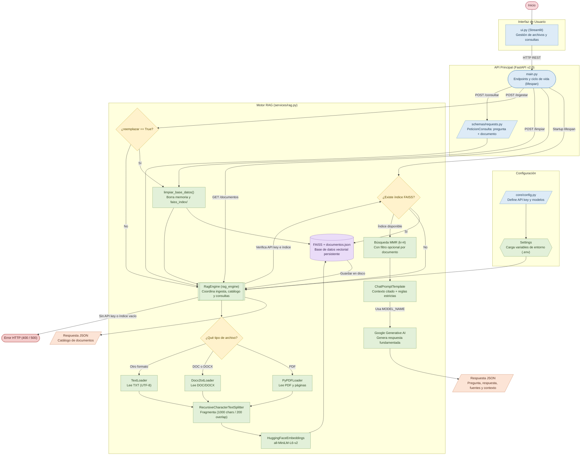
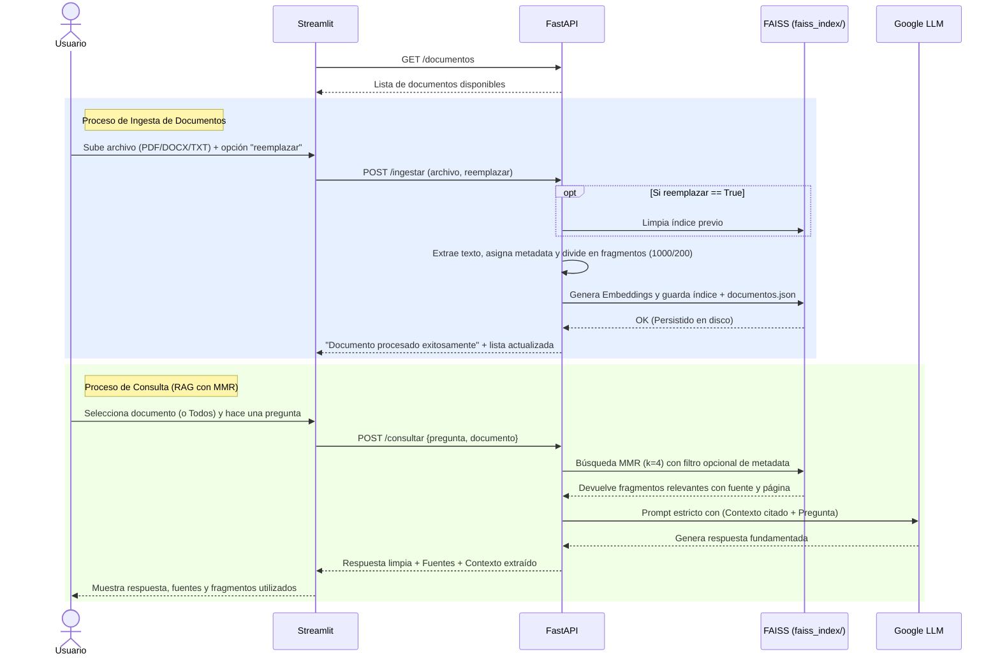

# 🤖 DocuMind AI


Un sistema avanzado de **Retrieval-Augmented Generation (RAG)** diseñado para procesar, vectorizar y consultar documentos de manera inteligente. Utilizando la potencia de **Google Gemini** y **FastAPI**, esta solución permite a los usuarios hacer preguntas en lenguaje natural sobre sus propios documentos (`PDF`, `DOCX`, `DOC` y `TXT`) a través de una interfaz visual intuitiva desarrollada con **Streamlit**, con soporte para filtrado por documento, citas por archivo/página y gestión completa de la base de conocimiento.

> 📘 **¿Buscas especificaciones de bajo nivel?** Consulta la [Documentación Técnica Completa (DOCUMENTACION_TECNICA.md)](DOCUMENTACION_TECNICA.md).

---

## 📊 Arquitectura del Sistema

El proyecto cuenta con una arquitectura moderna y desacoplada, separando claramente la interfaz de usuario del motor de inteligencia artificial.



### Flujo de Trabajo (Ingesta, Gestión y Consulta)

El siguiente diagrama de secuencia ilustra cómo interactúan los componentes internamente al gestionar documentos y realizar consultas:



---

## ✨ Ventajas y Fortalezas del Proyecto

- **Arquitectura Modular y Escalable**: Separación clara de responsabilidades entre rutas de la API (`main.py`), lógica del motor RAG (`services/rag.py`), validación de esquemas (`schemas/requests.py`) y configuración (`core/config.py`).
- **Recuperación Semántica Avanzada (MMR)**: Emplea *Maximal Marginal Relevance* (`k=4`) para recuperar fragmentos relevantes pero diversos, evitando redundancia en el contexto entregado al LLM.
- **Aislamiento y Filtrado por Documento**: Permite consultar sobre toda la base de conocimiento o filtrar por un archivo específico, evitando mezclar información de distintos proyectos o documentos.
- **Trazabilidad y Citas de Fuentes**: Cada respuesta indica de qué archivo y página proviene la información, e incluye un panel desplegable con los fragmentos exactos utilizados.
- **Base de Datos Vectorial Persistente y Administrable**: Guarda tanto los vectores de FAISS como el catálogo de archivos (`documentos.json`) en disco local, permitiendo además reemplazar o vaciar la base de conocimiento con un clic.
- **Ciclo de Vida Moderno**: Implementa manejadores `lifespan` de FastAPI para la carga automática del índice vectorial al iniciar el servidor.

---

## 🔌 Endpoints de la API

| Método | Ruta | Descripción |
| :---: | :--- | :--- |
| `POST` | `/ingestar` | Sube y vectoriza un archivo (`PDF`, `DOCX`, `DOC`, `TXT`). Acepta el campo booleano `reemplazar` para reiniciar la base de datos antes de indexar. |
| `POST` | `/consultar` | Recibe `{"pregunta": "...", "documento": "..."}` y devuelve la respuesta generada, las fuentes consultadas y el contexto utilizado. |
| `GET` | `/documentos` | Retorna la lista de documentos actualmente indexados en la base de conocimiento. |
| `POST` | `/limpiar` | Elimina todos los documentos indexados y reinicia la base de datos vectorial en memoria y en disco. |

---

## 📁 Estructura del Proyecto

```text
.
├── core/
│   └── config.py                # Centralización y validación de variables de entorno
├── schemas/
│   └── requests.py              # Modelos de Pydantic para el tipado estricto
├── services/
│   └── rag.py                   # Lógica core de IA: LangChain, FAISS, MMR y Gemini
├── flowchart/
│   └── flowchart.mmd            # Diagrama de flujo de interacción entre los archivos
├── faiss_index/                 # Persistencia local de FAISS y catálogo documentos.json
├── main.py                      # Entrypoint de la API (FastAPI v2.0)
├── ui.py                        # Interfaz de usuario interactiva (Streamlit)
├── Dockerfile                   # Definición de imagen Docker para API y UI
├── docker-compose.yml           # Orquestación multicontenedor con volumen persistente
├── requirements.txt             # Dependencias estrictas del proyecto
├── DOCUMENTACION_TECNICA.md     # Documentación técnica detallada de arquitectura y API
├── .env.example                 # Plantilla de variables de entorno
├── .dockerignore                # Reglas de exclusión para contexto de Docker
├── .gitignore                   # Reglas de exclusión para Git
└── README.md                    # Documentación principal
```

## 🛠️ Instalación y Requisitos

1. Asegúrate de tener **Python >= 3.9** instalado.
2. Clona este repositorio y navega a la carpeta del proyecto.
3. Crea y activa un entorno virtual (recomendado):

   ```bash
   python -m venv .venv
   # Windows:
   .venv\Scripts\activate
   # Linux/Mac:
   source .venv/bin/activate
   ```

4. Instala las dependencias necesarias:

   ```bash
   pip install -r requirements.txt
   ```

5. **Configura tus credenciales**:
   - Haz una copia del archivo `.env.example` y renómbralo a `.env`
   - Inserta tu API Key de Google Generative AI en el archivo:

     ```env
     GOOGLE_API_KEY=tu_api_key_aqui
     ```

## ▶️ Uso y Ejecución

El proyecto está diseñado para ejecutar el Backend y el Frontend de manera independiente. Necesitarás abrir dos terminales.

### 1. Levantar la API (Backend)

En tu primera terminal, levanta el motor principal:

```bash
uvicorn main:app --reload
```

*La API estará disponible en `http://localhost:8000`. Puedes consultar la documentación interactiva (Swagger) en `http://localhost:8000/docs`.*

### 2. Levantar la Interfaz Gráfica (Frontend)

En tu segunda terminal (con el entorno virtual activado), ejecuta:

```bash
streamlit run ui.py
```

*Se abrirá automáticamente en tu navegador web (`http://localhost:8501`). Desde ahí podrás subir tus documentos, gestionar la base de conocimiento y comenzar a hacer preguntas a la IA.*

---

## 🐳 Despliegue con Docker y Docker Compose

También puedes ejecutar todo el sistema (Backend + Frontend + Base de Datos Vectorial) empaquetado en contenedores Docker de forma automática.

### 1. Requisitos

- [Docker Desktop](https://www.docker.com/products/docker-desktop/) instalado y en ejecución.
- Archivo `.env` configurado con tu `GOOGLE_API_KEY`.

### 2. Levantar los Contenedores

Ejecuta en la raíz del proyecto:

```bash
docker compose up --build
```

*(o en segundo plano con `docker compose up --build -d`)*

### 3. Acceso a las Aplicaciones

- **Frontend (Streamlit)**: [http://localhost:8501](http://localhost:8501)
- **Backend (FastAPI)**: [http://localhost:8000](http://localhost:8000)
- **Documentación Swagger**: [http://localhost:8000/docs](http://localhost:8000/docs)

### 4. Detener los Contenedores

```bash
docker compose down
```

> **Nota de persistencia:** Los documentos y la base de datos vectorial se sincronizan automáticamente en la carpeta local `./faiss_index` mediante volúmenes, por lo que tus índices permanecen guardados incluso si apagas los contenedores.

## ⚙️ Stack Tecnológico

- **Backend**: FastAPI, Uvicorn, Pydantic (`pydantic-settings`)

- **Frontend**: Streamlit

- **Contenedores**: Docker, Docker Compose

- **IA y NLP**: LangChain, HuggingFace (`sentence-transformers/all-MiniLM-L6-v2`), Google Generative AI (`gemini-3.8-flash`)

- **Base de Datos Vectorial**: FAISS (`faiss-cpu`)

## 📄 Licencia

Este proyecto está bajo la Licencia MIT. Consulta el archivo [LICENSE](LICENSE) para más detalles.
