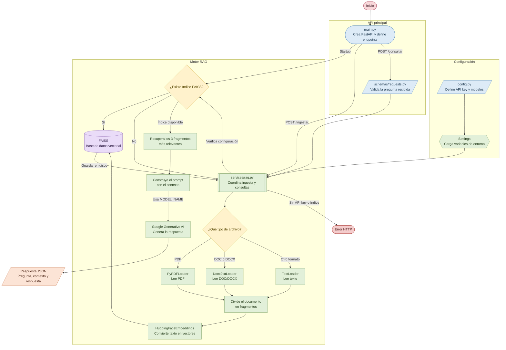
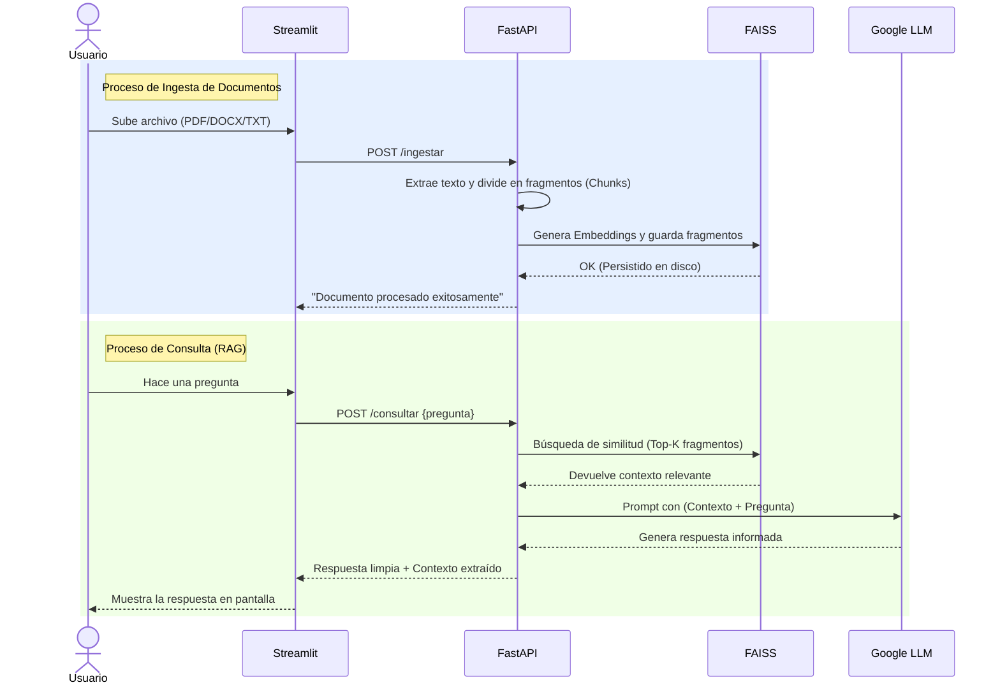

# 🤖 DocuMind AI


Un sistema avanzado de **Retrieval-Augmented Generation (RAG)** diseñado para procesar, vectorizar y consultar documentos de manera inteligente. Utilizando la potencia de **Google Gemini** y **FastAPI**, esta solución permite a los usuarios hacer preguntas en lenguaje natural sobre sus propios documentos (PDF, Word DOCX/DOC y TXT) a través de una interfaz visual intuitiva desarrollada con **Streamlit**.

---

## 📊 Arquitectura del Sistema

El proyecto cuenta con una arquitectura moderna y desacoplada, separando claramente la interfaz de usuario del motor de inteligencia artificial.



### Flujo de Trabajo (Ingesta y Consulta)

El siguiente diagrama de secuencia ilustra cómo interactúan los componentes internamente cuando subes un documento frente a cuando realizas una consulta:



---

## ✨ Ventajas y Fortalezas del Proyecto

- **Arquitectura Modular y Escalable**: Código limpio y organizado utilizando principios de diseño de software. Separación clara de responsabilidades entre las rutas de la API, la lógica del negocio (IA) y los modelos de datos.
- **Base de Datos Vectorial Persistente**: Utiliza FAISS para crear representaciones vectoriales (Embeddings) de los documentos. El conocimiento se guarda en disco localmente, garantizando que no se pierdan los datos tras reiniciar el servidor.
- **Interfaz Gráfica Intuitiva (UI)**: Desacopla la lógica del backend ofreciendo un frontend moderno con Streamlit. Los usuarios finales no necesitan usar comandos cURL o Postman; pueden arrastrar sus PDFs y chatear de inmediato.
- **Seguridad y Buenas Prácticas**: Manejo seguro de credenciales (API Keys) a través de variables de entorno y validación estricta de los datos de entrada y salida mediante Pydantic.
- **Ciclo de Vida Moderno**: Implementa manejadores de estado modernos (`lifespan`) de FastAPI para una correcta inicialización y limpieza de recursos (como la carga en memoria de los modelos de IA).

## 📁 Estructura del Proyecto

```text
.
├── core/
│   └── config.py          # Centralización y validación de variables de entorno
├── schemas/
│   └── requests.py        # Modelos de Pydantic para el tipado estricto
├── services/
│   └── rag.py             # Lógica core de IA: LangChain, FAISS y Gemini
├── flowchart/
│   └── flowchart.mmd      # Diagrama de flujo de interacción entre los archivos
├── main.py                # Entrypoint de la API (FastAPI)
├── ui.py                  # Interfaz de usuario (Streamlit)
├── requirements.txt       # Dependencias estrictas del proyecto
├── .env.example           # Plantilla de variables de entorno
├── .gitignore             # Reglas de exclusión para Git
└── README.md              # Documentación principal
```

## 🛠️ Instalación y Requisitos

1. Asegúrate de tener **Python >= 3.9** instalado.
2. Clona este repositorio y navega a la carpeta del proyecto.
3. Crea y activa un entorno virtual (recomendado):
   ```bash
   python -m venv .venv
   # Windows:
   .venv\Scripts\activate
   # Linux/Mac:
   source .venv/bin/activate
   ```
4. Instala las dependencias necesarias:
   ```bash
   pip install -r requirements.txt
   ```
5. **Configura tus credenciales**:
   - Haz una copia del archivo `.env.example` y renómbralo a `.env`
   - Inserta tu API Key de Google Generative AI en el archivo:
     ```env
     GOOGLE_API_KEY=tu_api_key_aqui
     ```

## ▶️ Uso y Ejecución

El proyecto está diseñado para ejecutar el Backend y el Frontend de manera independiente. Necesitarás abrir dos terminales.

### 1. Levantar la API (Backend)
En tu primera terminal, levanta el motor principal:
```bash
uvicorn main:app --reload
```
*La API estará disponible en `http://localhost:8000`. Puedes consultar la documentación interactiva (Swagger) en `http://localhost:8000/docs`.*

### 2. Levantar la Interfaz Gráfica (Frontend)
En tu segunda terminal (con el entorno virtual activado), ejecuta:
```bash
streamlit run ui.py
```
*Se abrirá automáticamente en tu navegador web. Desde ahí podrás subir tus documentos PDF/TXT y comenzar a hacer preguntas a la IA.*

## ⚙️ Stack Tecnológico
* **Backend**: FastAPI, Uvicorn, Pydantic
* **Frontend**: Streamlit
* **IA y NLP**: LangChain, HuggingFace (Embeddings), Google Generative AI (Gemini)
* **Base de Datos Vectorial**: FAISS

## 📄 Licencia

Este proyecto está bajo la Licencia MIT. Consulta el archivo [LICENSE](LICENSE) para más detalles.
